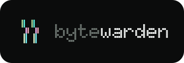

<p align="center"></p>

# Bytewarden

A browser password manager by Convex Works. Its interface is set in ink and lit subpixels. Bytewarden is an independent GPLv3 fork of Bitwarden's open-source browser extension.

## Develop and build

Use the Node version in `.nvmrc` and npm 11.

```sh
npm ci
npm run build
```

Load `apps/browser/build` as an unpacked extension in Chrome or another Chromium browser. For Firefox, run `npm run build:firefox`, then load `apps/browser/build/manifest.json` through `about:debugging`.

```sh
npm run test:types
npm test -- --selectProjects browser --runInBand
npm run dist
```

The Chrome distribution archive is written to `apps/browser/dist/dist-chrome.zip`. Existing Bitwarden and compatible self-hosted server endpoints remain supported; select the server on the login screen. This repository contains the browser extension and its shared libraries, without commercial modules. Desktop biometric and shared-unlock features require a native host configured to allow Bytewarden’s new extension ID; the stock Bitwarden host allows its own extension IDs.

## Branding

The Bytewarden logo is the **pixel tile**: two strands of lit stripes that slip one scanline out of step. The wordmark is set in Doto, and the interface uses Inter on a green-tinted ink palette, with JetBrains Mono for passwords and codes. `branding/README.md` documents the sources, colours, and usage rules. Run `npm run branding:assets` to regenerate the toolbar, store, Safari, popup, and in-app logo assets, and `npm run icons:build` to rebuild the icon font.

The theme stays a token layer (`libs/components/src/tw-theme.css` and `theme.css`) over upstream components, so upstream UI changes merge without restyling.

Product names, local package namespaces, internal identifiers, translations, toolbar icons, popup logos, and autofill branding use Bytewarden. Upstream copyright notices, the GPL SDK package name, external server domains, native desktop protocol identifiers and companion-app names, and import format identifiers retain their original names for attribution and compatibility.

## Source and license

Upstream checkpoint: [`browser-v2026.9.3`](https://github.com/bitwarden/clients/releases/tag/browser-v2026.9.3), commit `8246ae9c9a484a0a69f8b27203034555fb872523`.

See `LICENSE_GPL.txt` and `NOTICE.txt`. Bytewarden uses only the GPL SDK package, `@bitwarden/sdk-internal`. The restricted commercial code and its dependency are excluded. This repository starts with a clean source snapshot so its history does not redistribute the excluded modules.

Bytewarden is independently maintained and is not affiliated with or endorsed by Bitwarden Inc.
